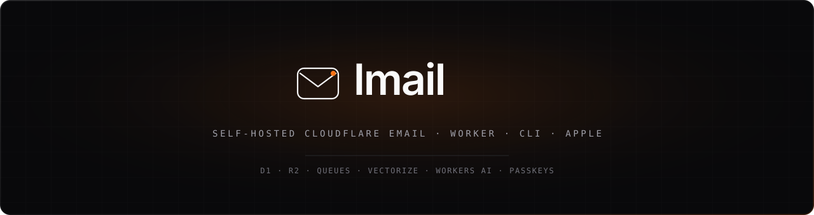

# lmail – Self-hosted Cloudflare-native email

[](./src/worker)
[](./cli)
[](./ios)
[](./LICENSE)

**lmail** is a self-hosted email system built on Cloudflare Workers, D1, R2, Queues, and Workers AI, paired with native iPhone, iPad, and Mac apps and a Rust CLI. It replaces traditional mail servers and browser webmail with an OpenAPI 3.1-contracted HTTP API, passkey sign-in, and scoped CLI access.

---

## Features

- **Cloudflare data plane** — Routes, stores, indexes, and sends mail using Email Routing, Queues, D1, R2, and Email Sending with no origin server.
- **Native Apple clients** — SwiftUI iPhone, iPad, and Mac apps with passkey + PKCE sign-in, offline cache, incremental delta sync, APNs push, and on-device demo mode.
- **Scoped Rust CLI** — `lmail` provides human-readable and `--json` commands for reading, sending, watching, auditing, and administering mailboxes.
- **Clef inbox autopilot** — Dual Cloudflare Clef decision models classify incoming mail, filter spam (~$0.37 per 1,000 messages, inside Cloudflare's free daily allowance), file routine notifications, draft replies in your style, and write a daily brief under a configurable spend cap.
- **OpenAPI 3.1 contract** — Complete machine-readable schema (`openapi/openapi.json` and `GET /openapi.json`) enforced in CI against every Worker route and CLI call.
- **External IMAP replication** — Mirrors existing IMAP/SMTP mailboxes into the same D1/R2 store and unified client experience.
- **Hardened & continuously audited** — Scoped, identity-allowlisted API keys, 30-day revocable native sessions, idempotent sending, blocked remote images, 180-day audit logs, and an in-repo `security-reviews/` register validated on every push.

---

## Quick start

```bash
git clone https://github.com/luka-loehr/luka-mail.git
cd luka-mail
npm ci
npm run test:all
```

To install the Rust CLI:

```bash
cargo install --path cli
lmail login --endpoint https://mail.example.com
```

See the [Self-Hosting Guide](./docs/SELF_HOSTING.md) for full Cloudflare setup, secrets, passkey enrollment, and Apple app configuration.

---

## Documentation

- [Self-Hosting Guide](./docs/SELF_HOSTING.md) — Cloudflare Worker, D1, R2, Queues, Email Routing, secrets, and CLI setup
- [HTTP API Reference](./docs/API.md) and [OpenAPI 3.1 Spec](./openapi/openapi.json) — Routes, schemas, scopes, rate limits, and error codes
- [App Store & Apple Apps Guide](./docs/APP_STORE.md) — Building iOS/macOS targets, signing overrides, demo mode, and push notifications
- [Security Model](./SECURITY.md) & [Security Reviews](./security-reviews/README.md) — Trust boundaries, passkey/PKCE flow, key scoping, and canonical audit register
- [Privacy Policy](./docs/PRIVACY.md) and [Support](./docs/SUPPORT.md)

---

## License

Apache License 2.0. See [LICENSE](./LICENSE).

---

## Support

Open an issue on [GitHub Issues](https://github.com/luka-loehr/luka-mail/issues) or email [luka@lukaloehr.com](mailto:luka@lukaloehr.com).

---

Developed by [Luka Löhr](https://github.com/luka-loehr)
